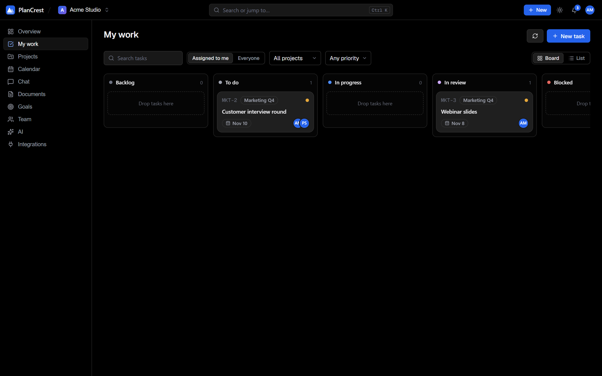
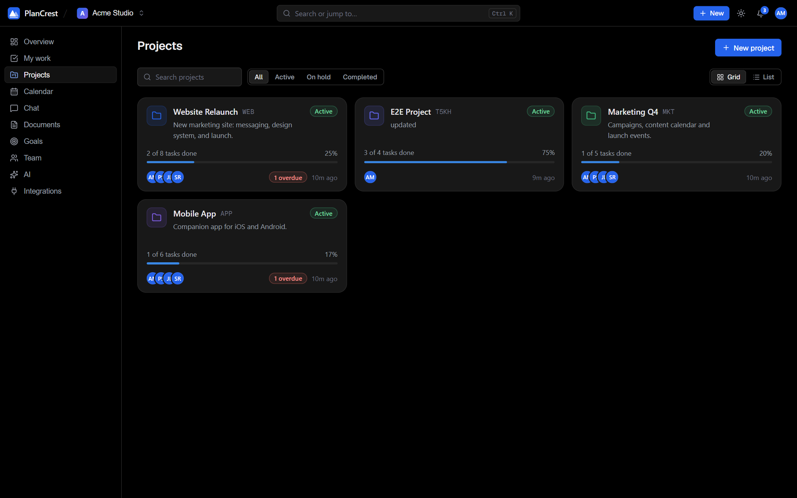
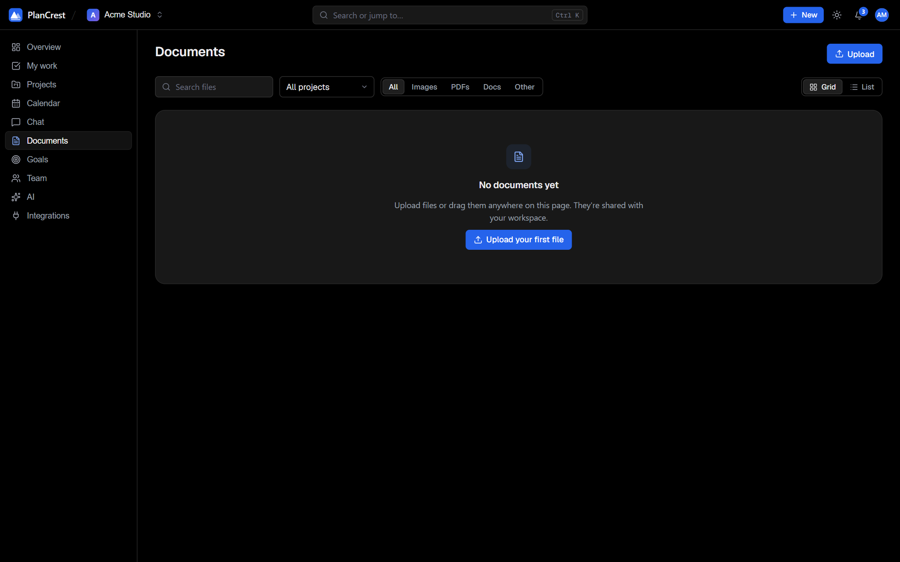
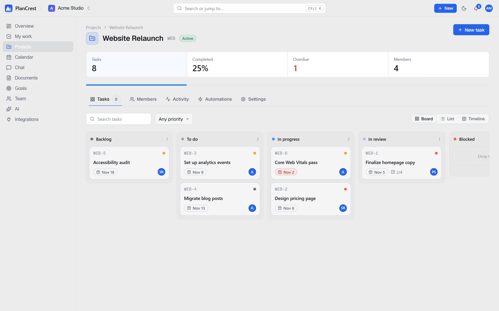
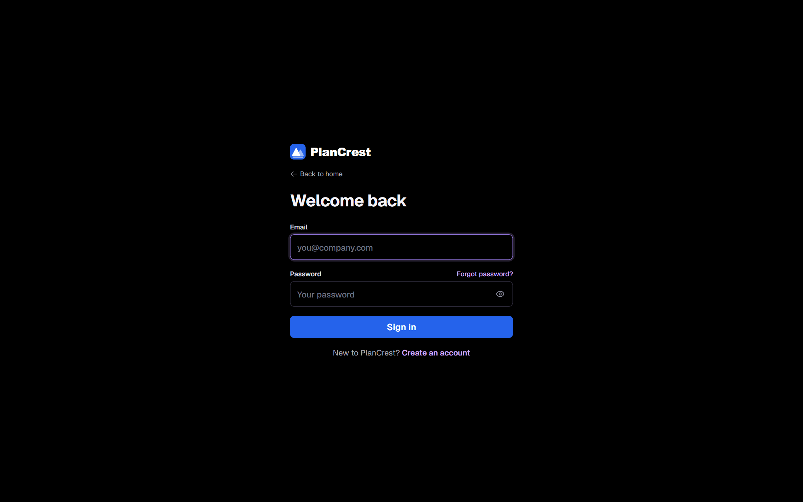

<p align="center">
  
</p>

<h1 align="center">PlanCrest</h1>

<p align="center">
  <b>Open source project management.</b><br />
  Boards, timelines, time tracking, goals, automations, chat, calendar and an AI assistant, in one workspace you host yourself.
</p>

<p align="center">
  <a href="LICENSE"></a>
  
  
  
  
</p>

<p align="center">
  <a href="#quick-start">Quick start</a> ·
  <a href="#features">Features</a> ·
  <a href="#configuration">Configuration</a> ·
  <a href="#ai-mode">AI Mode</a> ·
  <a href="#integrations">Integrations</a> ·
  <a href="docs/DEPLOYMENT.md">Deploy</a> ·
  <a href="docs/API.md">API</a>
</p>


---

## Contents

- [Why PlanCrest](#why-plancrest)
- [Quick start](#quick-start)
- [Features](#features)
- [Configuration](#configuration)
- [AI Mode](#ai-mode)
- [Integrations](#integrations)
- [Roles and permissions](#roles-and-permissions)
- [Project structure](#project-structure)
- [API](#api)
- [Testing and quality](#testing-and-quality)
- [Security](#security)
- [Deployment](#deployment)
- [Troubleshooting](#troubleshooting)
- [Contributing](#contributing)
- [License](#license)

---

## Why PlanCrest

Most teams juggle a task tracker, a chat app, a calendar, a time sheet and a pile of integrations. PlanCrest puts the work in one place and keeps the interface quiet:

- **Self hosted.** Your data lives in your own MongoDB database. Nothing is sent to a PlanCrest service, because there isn't one.
- **One workspace.** Tasks, conversations, files, dates, time and goals reference each other, so nothing goes stale.
- **Simple to run.** One command starts a demo. A short `.env` file starts the real thing.
- **Open.** MIT licensed, a documented API, and tests that run in seconds.

---

## Quick start

You need **Node.js 20 or newer**. MongoDB is only needed for real use; the demo brings its own.

### 1. Try it with demo data (no database, no setup)

```bash
git clone https://github.com/<your-account>/plancrest.git
cd plancrest
npm run setup     # installs server and client dependencies
npm run dev       # API on :8000, web app on :5173
```

Open **http://localhost:5173** and sign in with:

| Email | Password |
| --- | --- |
| `alex@plancrest.demo` | `PlanCrest-demo-1` |

`npm run dev` starts the API on a **throwaway in-memory MongoDB** filled with a sample workspace, so nothing is saved when you stop it. The first run downloads a MongoDB binary (about 500 MB, once).

### 2. Run it with your own database

```bash
cp .env.example server/.env        # then edit it: set DATABASE and JWT_SECRET
cp client/.env.example client/.env
npm --prefix server start          # API
npm --prefix client run build      # static web app in client/dist
```

Only two settings are required: `DATABASE` and `JWT_SECRET`. Everything else turns features on. See [Configuration](#configuration).

### 3. Docker

```bash
cp .env.example server/.env        # edit first
docker compose up --build
```

The web app is on **http://localhost:8080**, the API on **http://localhost:8000**, and MongoDB runs in its own container with a persistent volume.

### Commands

| Command | What it does |
| --- | --- |
| `npm run setup` | Install server and client dependencies |
| `npm run dev` | API (demo data) and web app together |
| `npm test` | Server tests: API behaviour, access control, AI fallback, env examples |
| `npm run smoke` | 100+ checks against a running `npm run dev` |
| `npm run lint` | ESLint for the web app |
| `npm run build` | Production build of the web app |
| `npm run check` | Lint, build and tests in one go |
| `npm run docs:api` | Regenerate [docs/API.md](docs/API.md) from the route files |

---

## Features

### Overview and My work

A quiet dashboard: open tasks, due this week, overdue, completed, a 7 or 14 day task flow chart, what's next for you, projects with progress, and recent activity. **My work** lists everything assigned to you in one place.

| Overview | My work |
| --- | --- |
|  |  |

### Projects, boards and timelines

Every project has three views of the same tasks:

- **Board.** Drag cards between Backlog, To do, In progress, In review, Blocked and Done.
- **List.** A dense table of the same tasks.
- **Timeline.** A Gantt style view from each task's start date to its due date, with a marker for today.

Projects also have members with their own roles, an activity feed, custom fields and automations.

| Projects | Board |
| --- | --- |
|  |  |


### Tasks

Open any task for everything in one page:

- Title, description, status, priority, due date and assignees.
- **Subtasks** with progress, and **comments**.
- **Time tracking.** Start a timer (visible in the top bar from any page), or log time by hand.
- **Dependencies.** Mark a task as *waiting on* another. A task can't be completed while something blocks it, and circular links are rejected.
- **Repeat.** Daily, weekly or monthly; completing the task creates the next one.
- **Custom fields** defined per project: text, number, date, select, checkbox or link.
- A discussion thread, an activity log, and links to GitHub, Jira or Trello items.


### Automations

Rules of the form *when X happens, do Y*, per project. Triggers: task created, status changed, priority changed, task assigned. Actions: set status, set priority, assign someone, add a tag, post a comment, notify a person. Each rule shows how often it has run and can be turned off without deleting it. Custom fields are defined on the same tab.


### Goals

Group measurable targets under one goal. A target can be a **number** (412 of 1000 signups), a **task** (done when the task is done) or a **yes/no** checkpoint. Progress rolls up into a percentage automatically.


### Team: members, workload, timesheet and activity

One area, four tabs:

- **Members.** Invite people, change roles, cancel pending invitations.
- **Workload.** Open and overdue work per person, with estimated hours, so you can rebalance before someone is overloaded.
- **Timesheet.** Time tracked per day over 7, 30 or 90 days; admins can look at anyone or everyone.
- **Activity.** Who changed what, across the workspace.

| Workload | Timesheet |
| --- | --- |
|  |  |

### Calendar

Events and task due dates in the same month grid or agenda. Create events with attendees and RSVP, attach a meeting link, email invitations, and sync with Google Calendar when it's connected.


### Chat

Channels for the workspace and for each project, direct messages, threads, reactions, mentions, pinned messages, file sharing and search, plus a discussion thread attached to every task. Channel settings let you rename, change the topic, manage members or delete. Messages arrive live through server sent events.


### Documents

Upload, preview, rename, share and delete files for the workspace. Access follows the same workspace and project permissions as everything else.



### AI Mode

An assistant that can look up your projects and tasks, plan your day, break a task into subtasks and create tasks from a sentence. It runs on the model provider you configure, with automatic fallback. [Details below](#ai-mode).


### Integrations

Connect Google Workspace, GitHub, Slack, Microsoft Teams, Jira and Trello from one page. [Details below](#integrations).


### Themes, settings and phones

Light and dark themes (or follow the system), a settings page for your profile, photo, password and notification preferences, and a layout that works at phone width.

| Settings | Light theme |
| --- | --- |
|  |  |

| Board, light | Dashboard on a phone | Task on a phone |
| --- | --- | --- |
|  |  |  |

### Public pages

A landing page and a single centered sign in card for register, verify email, forgot and reset password, and invitation links. Privacy and Terms pages are included as a starting point; have them reviewed for your organisation.

| Landing | Sign in |
| --- | --- |
|  |  |

---

## Configuration

Every setting is an environment variable, documented line by line in **[`.env.example`](.env.example)**. That file is the single reference: it lists each variable the code reads, marks it required, recommended or optional, and says where to get the value.

| File | What goes in it |
| --- | --- |
| [`.env.example`](.env.example) | The complete reference: server settings (sections 1 to 8) and web app settings (section 9) |
| [`server/.env.example`](server/.env.example) | Just the server settings. Copy to `server/.env` |
| [`client/.env.example`](client/.env.example) | Just the web app settings. Copy to `client/.env` |
| [`server/config.example.json`](server/config.example.json) | The same server settings as JSON, if you prefer `server/config.local.json` |

Real environment variables win over `.env`, and `.env` wins over `config.local.json`. All of these real files are git ignored; only the `*.example` files are committed. A test (`server/tests/env.test.js`) fails if the code starts reading a variable that the examples don't document, or if an example ever contains a real key.

### The two required settings

| Variable | Value |
| --- | --- |
| `DATABASE` | A MongoDB connection string, e.g. `mongodb://127.0.0.1:27017/plancrest` or an Atlas `mongodb+srv://...` URL |
| `JWT_SECRET` | 32 or more random characters: `node -e "console.log(require('crypto').randomBytes(32).toString('hex'))"` |

### Everything else, by feature

| Feature | Variables | Without them |
| --- | --- | --- |
| Integration token encryption | `ENCRYPTION_KEY` | Integrations can't store tokens safely, so set it before connecting any |
| URLs | `CLIENT_URL`, `API_PUBLIC_URL` (and optional `APP_URL`, `FRONTEND_URL`) | Defaults to localhost. Set both in production: they drive CORS, cookies, OAuth redirects and links in emails |
| Email | `EMAIL_SERVICE`, `EMAIL_USER`, `EMAIL_PASS`, `EMAIL_SENDER_NAME` | Sign up verification, password reset, invitations and reminders can't send |
| File uploads | `CLOUDINARY_CLOUD_NAME`, `CLOUDINARY_API_KEY`, `CLOUDINARY_API_SECRET` | Avatars and documents are disabled |
| Google sign in | `FIREBASE_PROJECT_ID` (server), `VITE_FIREBASE_*` (web app) | "Continue with Google" reports that it isn't configured |
| AI Mode | `LLM_FALLBACK_ORDER`, `OPENROUTER_*`, `GROQCLOUD_*`, `DEEPSEEK_*`, `AI_REQUESTS_PER_HOUR`, `AI_TIMEOUT_MS` | AI Mode shows a setup message |
| Integrations | `GOOGLE_*`, `GITHUB_*`, `SLACK_*` | Those providers show as not configured |
| Web app | `VITE_API_URL` | Defaults to `http://localhost:8000/api` |

**Gmail users:** a normal password will not work. Turn on 2 step verification, then create an **app password** (16 characters) at <https://myaccount.google.com/apppasswords> and use that as `EMAIL_PASS`, without spaces.

---

## AI Mode

AI Mode talks to any OpenAI compatible chat API. You choose the providers and models in the environment, and PlanCrest tries them in order until one answers.

```bash
LLM_FALLBACK_ORDER="openrouter,groqcloud,deepseek"

OPENROUTER_API_KEY=
OPENROUTER_MODELS="deepseek/deepseek-v4-flash,google/gemini-2.5-flash"

GROQCLOUD_API_KEY=
GROQCLOUD_MODELS="openai/gpt-oss-120b,openai/gpt-oss-20b"

DEEPSEEK_API_KEY=
DEEPSEEK_MODELS="deepseek-chat"
```

**How the fallback works**

1. Providers are tried in `LLM_FALLBACK_ORDER`; each provider's models are tried left to right.
2. A rejected key skips the rest of that provider's models.
3. A missing model, a timeout or an outage moves on to the next model.
4. A provider without a key, or with a placeholder such as `your_key_here`, is skipped.
5. The answer shows which model produced it, and usage is recorded per workspace.

**What it can do**

| Tab | Behaviour |
| --- | --- |
| Assistant | Ask about projects and tasks, or ask it to create a task. It looks things up through tools instead of guessing, and links to anything it creates. |
| Plan my day | Reads your open assigned tasks and suggests what to focus on and what can wait. |
| Task breakdown | Proposes subtasks for a task; you review them before they are added. |

**Privacy and limits.** The assistant only sees what the signed in user can already access. Requests are rate limited per user (`AI_REQUESTS_PER_HOUR`, default 60). Your request and the task details it looks up are sent to the provider you configured, so choose one that fits your data policy. Model ids differ per provider and per key; to list the ones your Groq key can use, run `curl -H "Authorization: Bearer $GROQCLOUD_API_KEY" https://api.groq.com/openai/v1/models`.

---

## Integrations

Open **Integrations** in the app. Each provider shows what it needs and whether the server is configured. OAuth providers share one OAuth app per group; register this redirect URL in each provider's console, using your own `API_PUBLIC_URL`:

```
{API_PUBLIC_URL}/api/integrations/<google|github|slack>/callback
```

| Provider | How you connect | Server settings | What you get |
| --- | --- | --- | --- |
| Google Calendar | OAuth (personal) | `GOOGLE_CLIENT_ID`, `GOOGLE_CLIENT_SECRET` | Two way event sync |
| Google Drive | OAuth (personal) | same Google app | Browse Drive and attach files to workspace documents |
| Google Meet | OAuth (personal) | same Google app | Create meeting links and schedule them on your calendar |
| Gmail | OAuth (personal) | same Google app | Turn emails into tasks and send mail from PlanCrest |
| GitHub | OAuth (personal) | `GITHUB_CLIENT_ID`, `GITHUB_CLIENT_SECRET` | Link repositories, sync issues to tasks and follow pull requests |
| GitHub Actions | Uses your GitHub connection | same GitHub app | Watch workflow runs, re-run failures and see build health per repository |
| Slack | OAuth (workspace) | `SLACK_CLIENT_ID`, `SLACK_CLIENT_SECRET` | Post task and project updates to a Slack channel |
| Microsoft Teams | Paste a workflow webhook URL (workspace) | none | Post updates to a Teams channel |
| Jira | Paste site, email and API token (workspace) | none | Import Jira issues as tasks and create issues from tasks |
| Trello | Paste API key and token (workspace) | none | Import cards from boards and push tasks out as cards |

Tokens are encrypted at rest with `ENCRYPTION_KEY`. Webhook and site URLs you paste are checked so internal and private addresses are rejected. Any task can be sent to GitHub, Jira or Trello from its page, and the link is kept on the task.

---

## Roles and permissions

| Level | Role | Can |
| --- | --- | --- |
| Workspace | **Owner** | Everything; the person who created the workspace |
| Workspace | **Admin** | Manage members, projects, integrations and workspace settings, including deleting the workspace |
| Workspace | **Member** | Work in the projects they belong to |
| Workspace | **Client** | View their projects; editing only if the workspace allows it |
| Project | **Admin** | Manage that project's members, automations and fields |
| Project | **Member** | Create and edit tasks |
| Project | **Viewer** | Read only |

Access is checked on the server for every request, including routes that only carry a task, comment or attachment id, so hiding something in the interface is never the only protection.

---

## Project structure

```
plancrest/
├── .env.example            every setting, documented
├── docker-compose.yml      MongoDB + API + web app
├── scripts/
│   ├── dev.mjs             npm run dev
│   └── routes.mjs          npm run docs:api
├── docs/
│   ├── ARCHITECTURE.md     how the parts fit
│   ├── DEPLOYMENT.md       production guide and go live checklist
│   ├── API.md              every route (generated)
│   └── screenshots/
├── server/                 Express 5 + Mongoose
│   ├── app.js              security middleware, auto mounts routes/
│   ├── routes/ controllers/ models/ middlewares/
│   ├── integrations/       provider registry, OAuth, actions, webhooks
│   ├── utils/ai/           provider fallback client and assistant tools
│   ├── scripts/            demo data and smoke test
│   └── tests/              node:test + supertest
└── client/                 React 19 + Vite 7 + Tailwind 4
    └── src/
        ├── pages/          one file per screen
        ├── components/     ui/ (primitives), shell/ (top bar, nav), feature folders
        ├── services/       API clients
        └── styles/         theme variables and component styles
```

More in [docs/ARCHITECTURE.md](docs/ARCHITECTURE.md).

---

## API

A JSON API under `/api`. Sign in returns a session cookie (and a bearer token you can use instead); errors are always `{ "error": "message" }`. Every route is listed in **[docs/API.md](docs/API.md)**.

```bash
# sign in and keep the cookie
curl -c jar -H "Content-Type: application/json" \
  -d '{"email":"alex@plancrest.demo","password":"PlanCrest-demo-1"}' \
  http://localhost:8000/api/login

# list your workspaces
curl -b jar http://localhost:8000/api/workspaces

# health check (no auth)
curl http://localhost:8000/api/health
```

---

## Testing and quality

```bash
npm run check     # lint + build + tests
npm test          # server tests only
npm run smoke     # 100+ end to end checks against a running `npm run dev`
```

- **`npm test`** starts an in-memory MongoDB and covers sign in and access control, workspaces, projects and tasks, time tracking, dependencies (including loop rejection), AI tool use and provider fallback, and the env examples.
- **`npm run smoke`** drives a running demo server through the main flows: auth, workspaces, projects, tasks, comments, time, dependencies, custom fields, automations, recurrence, goals, calendar, chat, notifications, integrations and AI. It uses the demo account, so never aim it at a real database.

---

## Security

What the code does, and where to look:

- **Passwords** are hashed with bcrypt. Sessions are JWTs in `httpOnly` cookies (`Secure` and `SameSite=None` in production).
- **CSRF.** State changing requests from untrusted browser origins are rejected (`server/middlewares/security.js`).
- **Access control** is enforced per object on the server (`server/middlewares/permissions.js`, `resourceAccess.js`).
- **Rate limits** on the API as a whole, on sign in and email routes, and on AI requests per user.
- **Headers.** `helmet` on the API; the Docker web image sends a Content Security Policy and other security headers.
- **Secrets.** Integration tokens are encrypted at rest, `.env` files are git ignored, and a test fails if an example file ever contains a real key.
- **SSRF.** User supplied URLs for Jira and webhooks are validated and private ranges rejected.
- **Dependencies.** Lockfiles are committed and `npm audit` reports no known vulnerabilities in production dependencies at the time of writing.

This is a description of the design, not a guarantee. Please report problems privately: see [SECURITY.md](SECURITY.md).

---

## Deployment

The short version: set `NODE_ENV=production`, use HTTPS for both the web app and the API, set `CLIENT_URL` and `API_PUBLIC_URL` to the real addresses, use fresh values for `JWT_SECRET` and `ENCRYPTION_KEY`, and register the OAuth callback URLs. The full guide, with a go live checklist, is in **[docs/DEPLOYMENT.md](docs/DEPLOYMENT.md)**.

---

## Troubleshooting

| Symptom | Likely cause and fix |
| --- | --- |
| Server exits with "Missing required environment variables" | Set `DATABASE` and `JWT_SECRET` in `server/.env` |
| `npm run dev` pauses on first start | It is downloading a MongoDB binary for the demo database; this happens once |
| Verification or invite emails never arrive | Check `EMAIL_*`. For Gmail, use a 16 character app password, not your account password |
| "Account created but the verification email could not be sent" | Same as above; fix the email settings and use "Resend" |
| Signed in but immediately signed out in production | The API must be served over HTTPS with `NODE_ENV=production`, and `CLIENT_URL` must match the web app's exact origin |
| An integration says "not configured" | Add its `*_CLIENT_ID` and `*_CLIENT_SECRET` and restart the server |
| OAuth returns "redirect_uri_mismatch" | The callback registered with the provider must exactly equal `{API_PUBLIC_URL}/api/integrations/<group>/callback` |
| AI Mode says it isn't set up | Add a key and a model list for at least one provider, then restart |
| AI answers but from an unexpected model | An earlier provider failed; the model that answered is shown under each reply |
| A page is blank after editing code on OneDrive | The dev server missed the change. Restart `npm run dev` |

---

## Contributing

Contributions are welcome. Start with [CONTRIBUTING.md](CONTRIBUTING.md): run `npm run check` before opening a pull request, add a test when API behaviour changes, and add any new setting to `.env.example`. Please follow the [Code of Conduct](CODE_OF_CONDUCT.md).

## License

[MIT](LICENSE). Use it, change it, ship it.
