<p align="center">
  
</p>

<h1 align="center">PlanCrest</h1>

<p align="center">
  Open source project management for teams: boards, tasks, calendar, docs, chat, time tracking and an AI assistant in one self hostable workspace.
</p>

<p align="center">
  <a href="LICENSE">MIT license</a> · React · Express · MongoDB · <a href="docs/ARCHITECTURE.md">Architecture</a> · <a href="docs/DEPLOYMENT.md">Deployment</a>
</p>

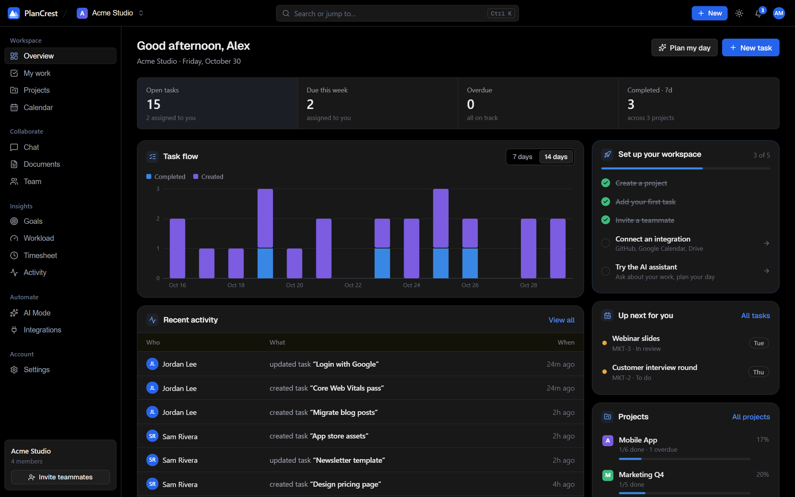

## Screenshots

All screenshots are from the built in demo (`npm run dev:demo`), signed in as the demo owner.

| | |
| --- | --- |
| 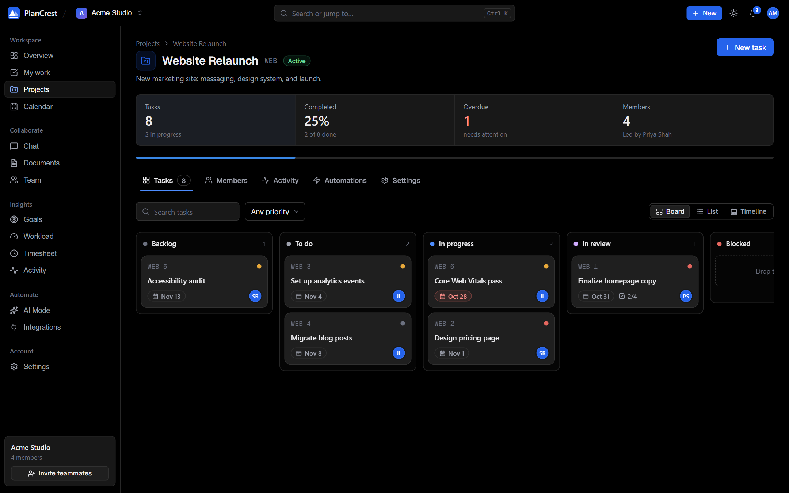 **Project board** with drag and drop columns | 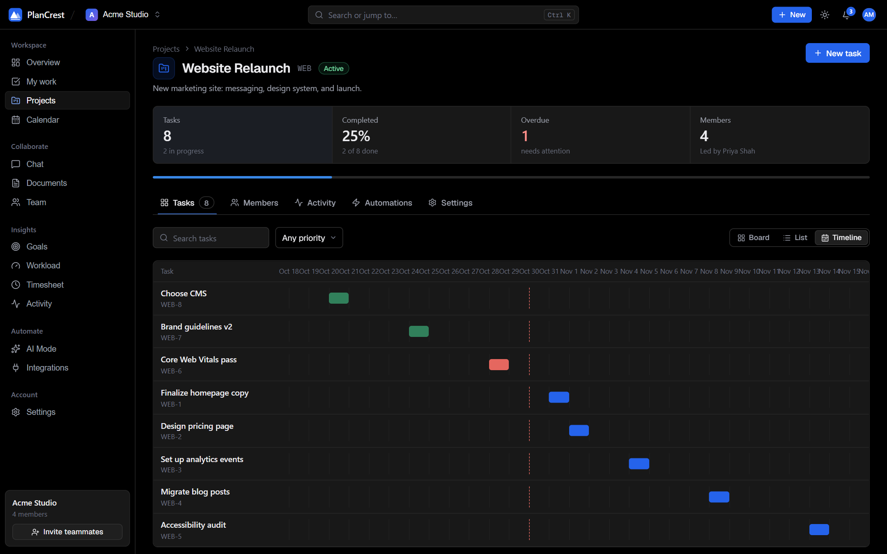 **Timeline (Gantt) view** |
| 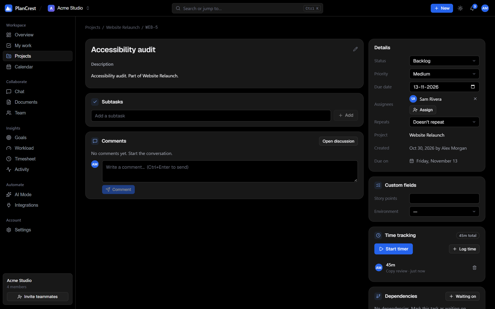 **Task detail** with time tracking, dependencies and repeat | 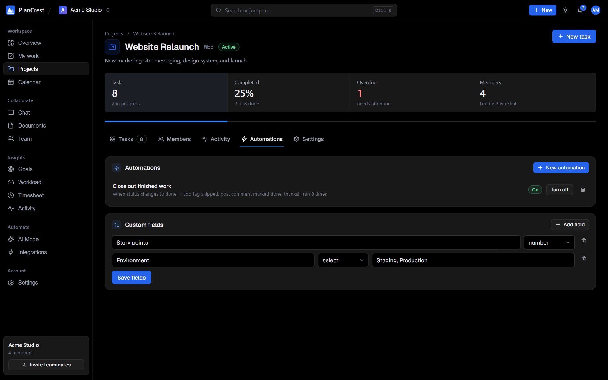 **Automations and custom fields** |
| 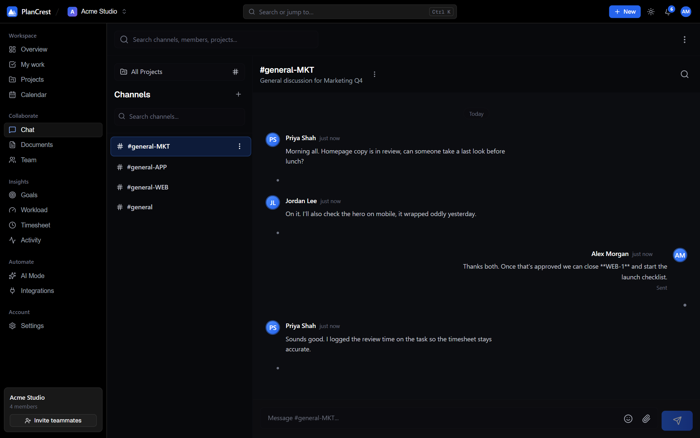 **Team chat** with channels | 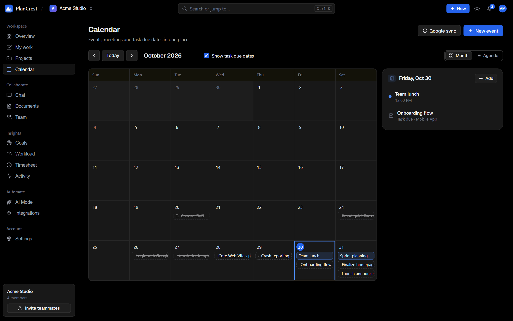 **Calendar** with events and due dates |
| 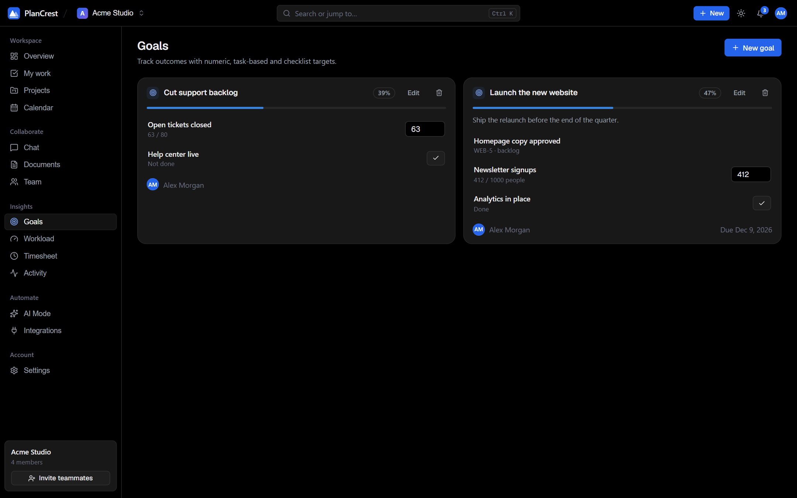 **Goals** with measurable targets | 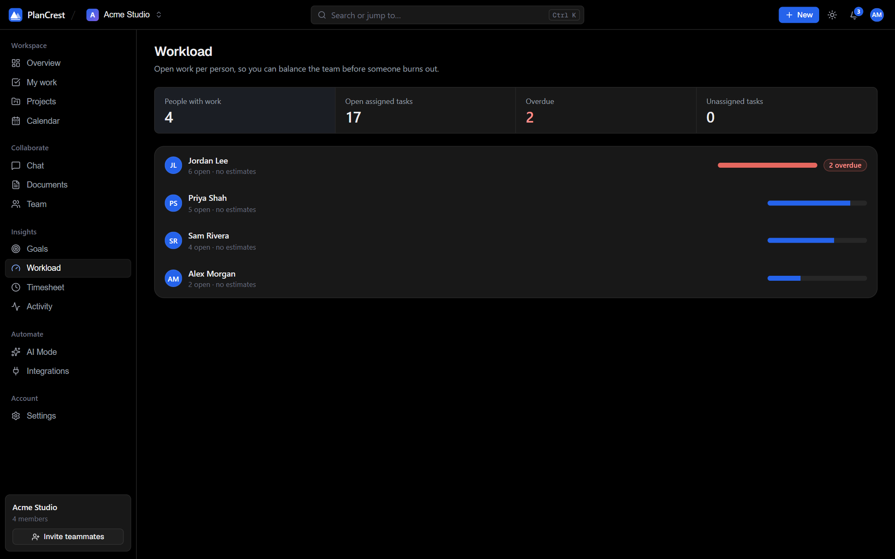 **Workload** per person |
| 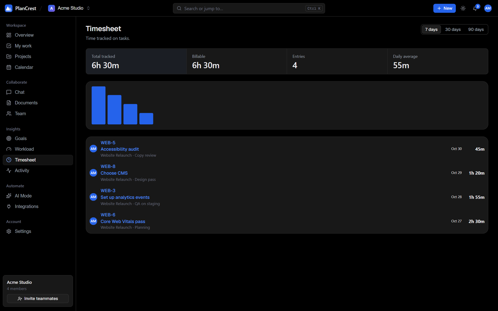 **Timesheet** | 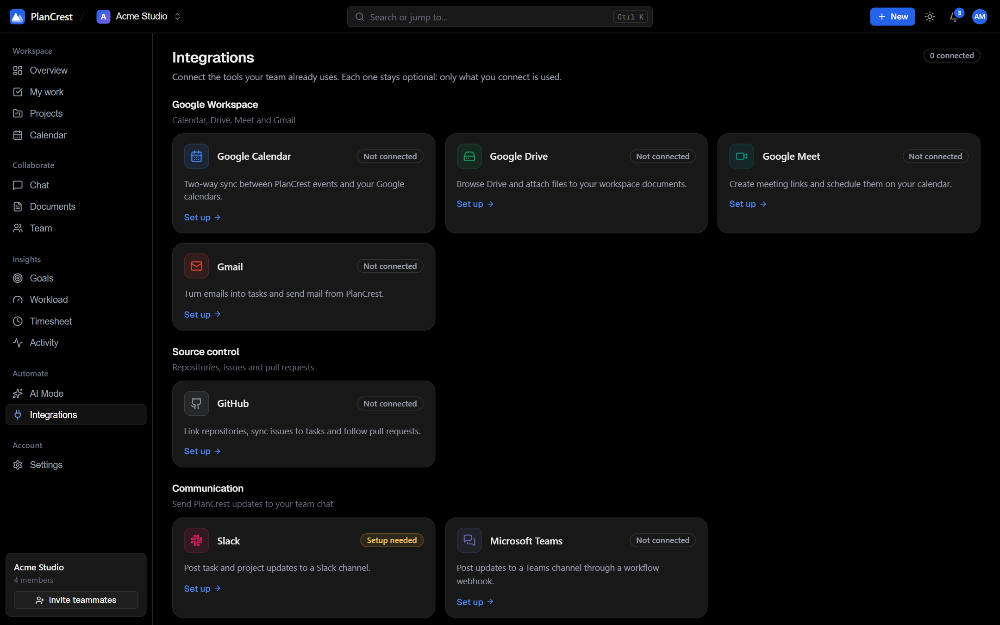 **Integrations hub** |
| 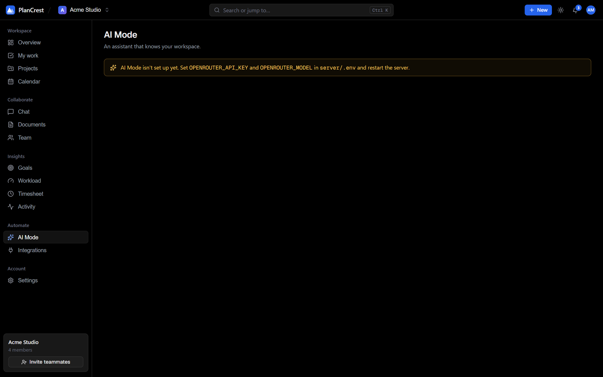 **AI Mode** | 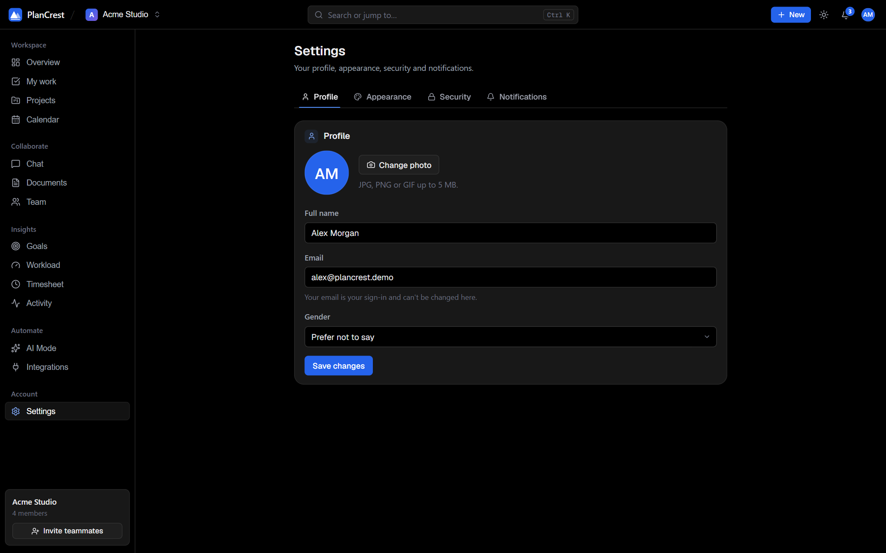 **Settings** with theme picker |
| 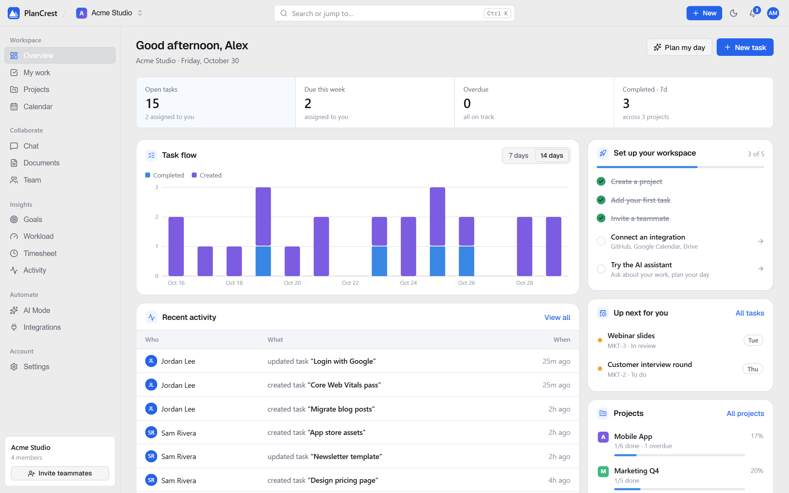 **Light theme** | 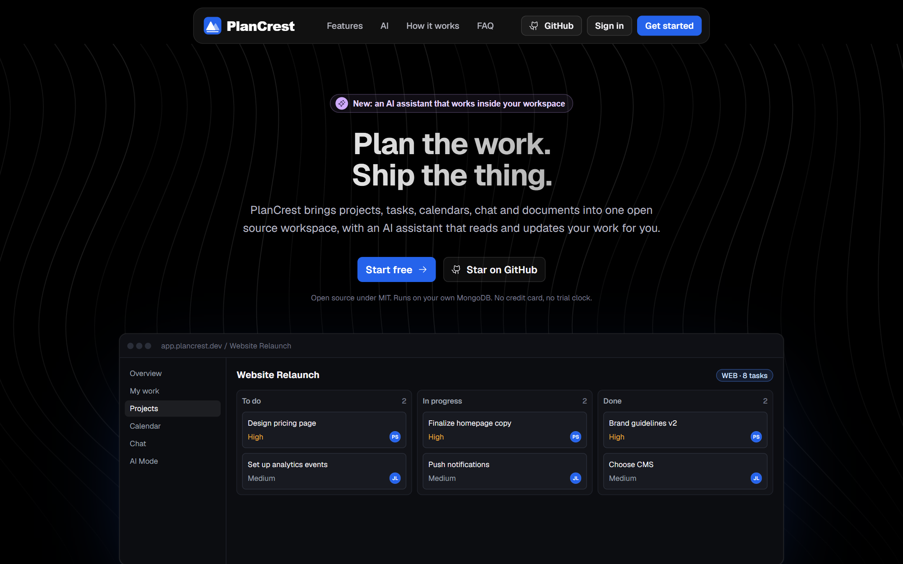 **Landing page** |

<p align="center">
  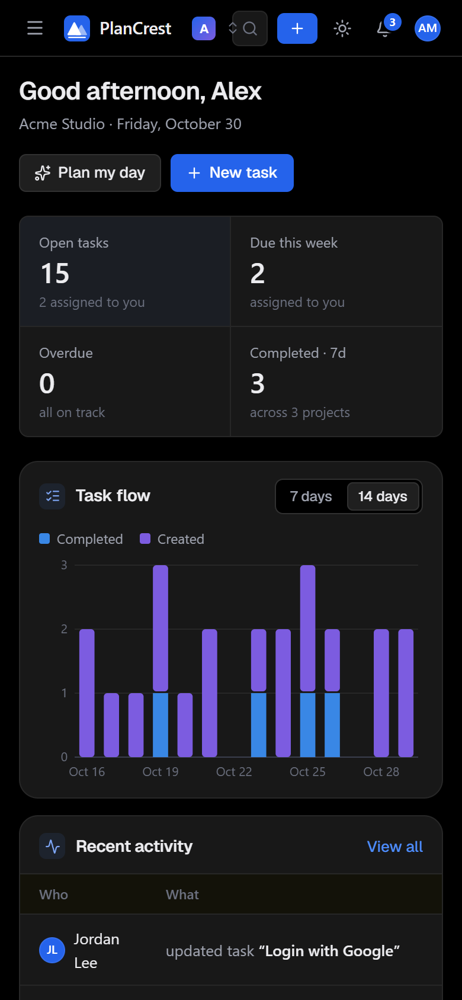
  &nbsp;
  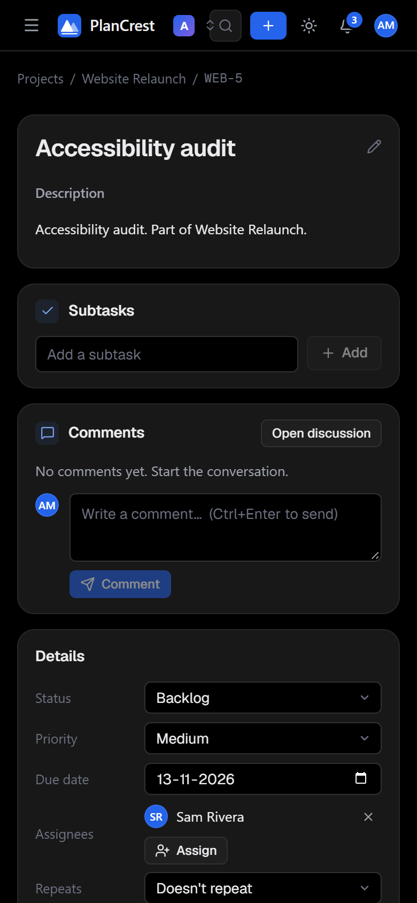
</p>

## Features

**Plan and track work**
- Projects with Board, List and Timeline (Gantt) views, drag-and-drop status changes and subtasks
- Task dependencies ("waiting on"), with circular-dependency protection and completion blocking
- Repeating tasks, custom fields per project, labels, priorities, assignees and comments
- Automations: "when a task is created / changes status / priority / is assigned, then set status, assign, tag, comment or notify"
- Goals with numeric, task-linked and yes/no targets that roll up into a progress score
- Workload view (open work and estimated hours per person) and a timesheet
- Time tracking: one-click timer visible everywhere, manual entries, billable flag

**Collaborate**
- Real-time chat with channels, direct messages, threads, mentions and reactions
- Calendar with events, attendees, RSVP and task due dates
- Documents with sharing and previews
- Invite teammates and clients by email, with workspace and project roles

**Integrations**
- Google Workspace: Calendar, Drive, Meet and Gmail
- GitHub (issues and pull requests) and GitHub Actions
- Slack and Microsoft Teams notifications
- Jira and Trello import/export

**AI Mode** (optional, via [OpenRouter](https://openrouter.ai)): ask about your projects, create tasks in plain language, plan your day and break a task into subtasks. The model is a single environment variable, so you can switch it at any time.

Light and dark themes, keyboard command palette (`Ctrl/⌘ K`), and a responsive layout.

## Quick start

You need Node.js 20+ and a MongoDB database (or use the demo mode below).

```bash
git clone https://github.com/<your-account>/plancrest.git
cd plancrest

# API
cd server
cp .env.example .env      # fill in DATABASE, JWT_SECRET, ENCRYPTION_KEY, CLIENT_URL
npm install
npm run dev               # http://localhost:8000

# Web app (new terminal)
cd client
cp .env.example .env
npm install
npm run dev               # http://localhost:5173
```

### Try it without a database

```bash
cd server
npm install
npm run dev:demo
```

`dev:demo` starts the API on a throwaway in-memory MongoDB filled with demo data, so nothing is written anywhere. The first run downloads a MongoDB binary. Then start the client and sign in with `alex@plancrest.demo` / `PlanCrest-demo-1`.

### Docker

```bash
cp server/.env.example server/.env   # edit the values first
docker compose up --build
```

The web app is served on http://localhost:8080 and the API on http://localhost:8000. MongoDB runs in a container with a persistent volume.

## Configuration

Everything is configured through environment variables; see [`server/.env.example`](server/.env.example) and [`client/.env.example`](client/.env.example). If you prefer a file, put the same keys in `server/config.local.json` (template: [`server/config.example.json`](server/config.example.json)); `.env` and real environment variables take priority. Both files are git ignored.

For production settings and a go live checklist, see [docs/DEPLOYMENT.md](docs/DEPLOYMENT.md).

| Variable | Purpose |
| --- | --- |
| `DATABASE` | MongoDB connection string |
| `JWT_SECRET` | Signs session cookies |
| `ENCRYPTION_KEY` | Encrypts integration tokens at rest |
| `CLIENT_URL` / `API_PUBLIC_URL` | Where the web app and API are reachable |
| `EMAIL_*` | SMTP for verification, invites and reminders |
| `CLOUDINARY_*` | File and avatar uploads |
| `OPENROUTER_API_KEY` / `OPENROUTER_MODEL` | Enables AI Mode and picks the model |
| `GOOGLE_*`, `GITHUB_*`, `SLACK_*` | OAuth apps for the integrations you want |

### Setting up integrations

Open **Integrations** in the app: each provider shows what it needs and whether the server is configured. For OAuth providers, register an app and use this callback URL:

```
{API_PUBLIC_URL}/api/integrations/<google|github|slack>/callback
```

Jira, Trello and Microsoft Teams connect with credentials or an incoming-webhook URL you paste into the app.

## Project layout

```
client/   React 19 + Vite + Tailwind CSS app
server/   Express 5 + Mongoose API
  integrations/   provider registry, OAuth, actions and webhooks
  controllers/ routes/ models/ middlewares/ utils/
  tests/          node:test + supertest suite
```

## Scripts

| Where | Command | What it does |
| --- | --- | --- |
| `server` | `npm run dev` | API with auto-reload |
| `server` | `npm run dev:demo` | API on in-memory demo data |
| `server` | `npm test` | Run the API tests |
| `client` | `npm run dev` | Vite dev server |
| `client` | `npm run build` | Production build |
| `client` | `npm run lint` | ESLint |

## Contributing

Contributions are welcome. Please read [CONTRIBUTING.md](CONTRIBUTING.md) and the [Code of Conduct](CODE_OF_CONDUCT.md). To report a vulnerability, see [SECURITY.md](SECURITY.md).

## License

[MIT](LICENSE)
